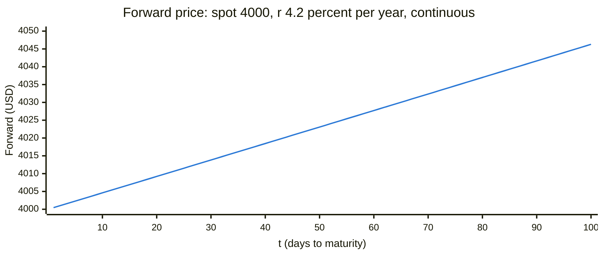

# Forward simulation

จำลองราคา futures ตามอายุคงเหลือ เพื่อตอบคำถามเดียวว่า **carry 4.2%/ปี คิดเป็นเงินเท่าไหร่**

```
F = S × e^(r × t/365)          S = 4000 คงที่,  r = 4.2%,  t = 1..100 วัน
```

> ⚠️ **ใช้ continuous compounding ต่างจากส่วนที่เหลือของโปรเจกต์**
> `Front` กับ `dashboard.py` ใช้ simple interest (เหตุผลอยู่ใน
> [ANALYSIS.md ส่วนที่ 0](ANALYSIS.md)) เอกสารนี้จงใจใช้เป็นภาพรวม
> อย่าเอาตัวเลขไปเทียบกับชีตตรง ๆ — ที่ t=100 สองแบบต่างกัน 0.27 ดอลลาร์



## อ่านเป็นตัวเลข

| t (วัน) | F | ส่วนต่างจาก spot | เฉลี่ย $/วัน |
|---|---|---|---|
| 1 | 4000.46 | +0.46 | 0.460 |
| 7 | 4003.22 | +3.22 | 0.460 |
| 14 | 4006.45 | +6.45 | 0.461 |
| 30 | 4013.83 | +13.83 | 0.461 |
| 60 | 4027.71 | +27.71 | 0.462 |
| 90 | 4041.64 | +41.64 | 0.463 |
| 100 | 4046.29 | +46.29 | 0.463 |

**ตัวเลขที่ควรจำ: ~0.46 ดอลลาร์ต่อวัน ต่อทอง 1 ออนซ์** ที่ spot 4000 และ 4.2%

เอาไว้คำนวณในหัวได้เลย — สัญญาที่อายุยาวกว่าอีก 45 วันควรแพงกว่าราว 21 ดอลลาร์
ถ้าเห็นตัวเลขต่างจากนี้มาก แปลว่า r ที่ตลาดคิดอยู่ไม่ใช่ 4.2%

## ทำไมกราฟถึงเป็นเส้นตรง

สูตรเป็น exponential ก็จริง แต่ที่ 4.2% ใน 100 วัน มัน**โค้งไม่ทัน**

```
ช่วงค่าทั้งกราฟ      4000.46 -> 4046.29   กว้าง 45.83
เบี่ยงจากเส้นตรงสูงสุด  0.065 ดอลลาร์ ที่ t=51  =  0.14% ของช่วง
```

กราฟสูง 380px ความโค้งทั้งหมดคือ **ครึ่งพิกเซล** ตาเปล่าแยกไม่ออก

สังเกตจากคอลัมน์ `$/วัน` ในตารางก็ได้ — ขยับจาก 0.460 เป็น 0.463 ตลอด 100 วัน
นั่นคือดอกทบต้นทั้งหมดที่เกิดขึ้นในช่วงนี้

เหตุผลเดียวกับที่ continuous กับ simple ต่างกันแค่ไม่กี่ bp ในช่วงอายุที่โปรเจกต์ใช้จริง

## สร้างใหม่ / เปลี่ยนค่า

ตัวเลขในกราฟเป็นค่าคงที่ ถ้าจะเปลี่ยน spot หรือ r ใช้คำสั่งนี้สร้างชุดใหม่

```bash
uv run python -c "import math; S,r=4000.0,0.042; print(', '.join('%.2f'%(S*math.exp(r*t/365)) for t in range(1,101)))"
```

แล้ววางทับใน `line [...]` ของบล็อก mermaid พร้อมปรับ `y-axis` ให้ครอบช่วงค่าใหม่
